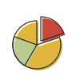
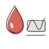

# 개인 웹 디자인 시스템

개인 사이트(듣는 교재 등) 화면의 색·글자·간격·부품 기준. 사내 디자인 시스템 2026-10-07판을 바탕으로 2026-10-13 개인용으로 고침. 2026-10-14 주색을 라벤더로, 바탕을 연노랑으로 정함(사용자 선택).
회사 이름·로고·제품 그림·캐릭터 그림·사내 사이트 전용 부품은 뺌. 회사 것과 다른 점은 9절.

## 1. 기준과 파일

- `design-system.md`: 이 문서. 규칙.
- `assets/tokens.css`: 글꼴·토큰·공용 부품(상단·머리글·카드·단추·칩·입력칸·표·글 본문·아이콘·그림 카드).
- `assets/icons.svg`: 선형 아이콘(`i-*`)·사이트 표식(`m-*`) 심볼 모음(8절). 페이지 `<body>` 첫머리에 인라인해 씀.
- `assets/fig/`: 손그림 세트(8절). 사이트 표식·머리글 그림·첫 화면 카드·글 삽화에 같은 그림을 씀.
- `assets/fonts/`: Pretendard 줄인 파일 3벌. 다시 만드는 스크립트 `scripts/make-fonts.py`.
- `preview.html`: 부품 견본. 미리보기 서버 `design-system`(8766)으로 봄. `file://` 로 열면 아이콘·글꼴이 안 나옴.
- 적용 대상: 듣는 교재(`D:\_personal\study-podcast`). 사이트는 `tokens.css`·`fonts/`·필요한 심볼·그림을 `public/` 에 복사해 씀.
- 값을 바꿀 때는 이 폴더를 먼저 고치고 사이트로 복사함. 사이트 쪽에서 먼저 고치지 않음.

## 2. 글꼴

- 본문·제목: Pretendard 1.3.9. 굵기는 400(본문)·700(제목·강조) 두 가지. 500은 필요할 때만, 600은 쓰지 않음.
- 줄인 파일: KS X 1001 한글 2,350자 + 영문·숫자·기호. 1벌 약 210KB (원본 약 760KB). 목록 밖 글자는 다음 글꼴(맑은 고딕)로 그려짐.
- 외부 CDN 은 쓰지 않음. 사이트에 파일을 같이 올림.
- 다시 만들 때: `python scripts/make-fonts.py <원본 woff2 폴더>` (fonttools·brotli 필요). 스크립트의 `used_chars()` 는 `docs/`·`posts/` 폴더를 보므로 없으면 건너뜀.
- 고정폭 글꼴(`--font-mono`)은 코드에만 씀. 날짜·분류·라벨에는 쓰지 않음.
- 라이선스: SIL Open Font License 1.1 (https://github.com/orioncactus/pretendard).

## 3. 색

| 구분 | 토큰 | 값 | 쓰는 곳 |
|---|---|---|---|
| 글자 | `--text-primary` | `#1f1f1f` | 본문·제목 |
| 글자 | `--text-secondary` | `#6f6a63` | 설명·작성 정보·목록 설명 |
| 글자 | `--text-placeholder` | `#aaa59d` | 입력 안내·점 구분자 |
| 주색 | `--brand` / `--text-brand` | `#7f65aa` | 라벤더. 링크·선택된 메뉴·탭 밑줄·포커스 선·진도 막대. 흰 바탕 4.8:1, 연노랑 바탕 4.6:1. 대비 때문에 이보다 연하게 못 함 |
| 주색 | `--brand-hover` | `#6a4c9c` | 링크 올렸을 때 |
| 주색 | `--brand-fill` / `--brand-fill-hover` | `#d8d0e5` / `#ccc2dd` | 주 단추·선택된 필터 칩의 파스텔 면 |
| 주색 | `--on-brand` | `#5e4390` | 파스텔 면 위 글자 (4.6:1 이상). 주색 분류 칩 글자도 이 값 |
| 주색 | `--bg-brand-soft` | `#e7e2ef` | 주색 분류 칩 바탕 |
| 분류 | `--text-pink` / `--bg-pink` | `#a8386a` / `#fbe4ec` | 핑크 분류 칩(`.chip.pink`) 5.1:1 |
| 분류 | `--text-yellow` / `--bg-yellow` | `#6e5300` / `#f4e9c8` | 노랑 분류 칩(`.chip.yellow`) 6.0:1 |
| 손그림 | `--ink` | `#2b2a28` | 손그림 먹선, 상단 사이트 표식 선 |
| 분류 | `--text-green` / `--bg-green` | `#5a6c18` / `#ebf0d3` | 연두(올리브) 분류 칩(`.chip.green`). 정상 초록과 뜻을 나눔: 연두는 분류, 초록은 정상 판정 |
| 상태 | `--text-success` / `--bg-success` | `#2f6b3a` / `#e2eee3` | 정상 (숲 초록) |
| 상태 | `--text-caution` / `--bg-caution` | `#7a5600` / `#f8ecc6` | 주의 (머스터드) |
| 상태 | `--text-warning` / `--bg-warning` | `#9a4a14` / `#f9dfcc` | 경고 (벽돌) |
| 상태 | `--text-error` / `--bg-error` | `#ad3328` / `#f9e2de` | 오류 (고추) |
| 상태 | `--text-info` / `--bg-info` | `#355c8d` / `#e3e9f1` | 정보 (슬레이트 파랑) |
| 분류 | `--text-violet` / `--bg-violet` | `#7a5e8c` / `#f1ebf6` | 보라 분류 칩(`.chip.violet`) 4.7:1. 분류 미상에도 씀 |
| 상태 | `--text-neutral` / `--bg-neutral` | `#5c5852` / `#efede8` | 기타 (따뜻한 회색) |
| 바탕 | `--bg-canvas` | `#fcfaef` | 페이지 바탕(연노랑). 이 위 보조 글자 5.1:1 |
| 바탕 | `--bg-surface` | `#fff` | 카드·입력칸·글 종이 |
| 바탕 | `--bg-sunken` / `--bg-sunken-2` | `#f6f5f2` / `#edebe6` | 목록 올렸을 때·코드·보조 단추 |
| 선 | `--border-1` / `--border-2` / `--border-3` | `#eeece7` / `#e4e1db` / `#d6d2cb` | 행 사이 / 표·입력칸 / 카드 테두리 |

- 바탕은 연노랑(`--bg-canvas`) 위에 흰 카드. 바탕·카드가 둘 다 흰색이면 1px 선으로만 나뉘어 화면이 한 장으로 보임.
- 주색(라벤더)은 선택된 것·누를 것에만 씀. 제목·라벨을 주색으로 칠하지 않음. 주 단추·선택된 필터 칩은 진한 면이 아니라 파스텔 면(`--brand-fill`) + 진한 글자(`--on-brand`)로 연하게 둠 (2026-10-14 사용자 결정).
- 상태색 글자는 칩 바탕 위 4.5:1 이상(흰 바탕 6.2:1 이상)인 값임. 칩·숫자 강조·안내에만 씀.
- 회색은 푸른 기운이 없는 따뜻한 회색임. 표 머리 줄은 `#f8f7f4`.
- 종류·축·성격을 나누는 분류 칩에는 상태색을 쓰지 않음. 분류 색은 라벤더(`brand`)·핑크(`pink`)·노랑(`yellow`)·보라(`violet`)·연두(`green`)·회색(기본) 여섯 가지. 회사 것의 청록 분류 칩(`teal`)은 없앰.

### 손그림 세트 색

그림(8절)에만 쓰는 색. 화면 글자·칩에는 쓰지 않음.

| 이름 | 값 | 비고 |
|---|---|---|
| 크림 | `#f7f3e8` / 진한 `#efe9d8` | 종이·흰 물건 |
| 따뜻한 회색 | `#e6e3dc` / `#d9d6cf` | 판·틀 |
| 진회색 | `#4a4744` | 검은 물건 |
| 머스터드 | `#e0b63d` / 밝은 `#ecd27a` / 진한 `#c99e2c` | 동전·태그·책등 |
| 세이지 | `#b9cb8e` | 식물·냄비 |
| 올리브 | `#8fa63c` | 세이지 진한 짝 |
| 고추 | `#c9463a` / `#d9655a` | 방울·강조 |
| 복숭아 | `#e9a68f` | 살구빛 면 |
| 먹선 | `#2b2a28` | 모든 선 (`--ink`) |

## 4. 글자 크기

| 크기 | 굵기 | 쓰는 곳 |
|---|---|---|
| 24px | 700 | 페이지 제목 |
| 20px | 700 | 글 본문 큰 제목(h2), 폰 폭 페이지 제목 |
| 19px | 700 | 그림 카드 이름 |
| 18px | 700 | 카드 제목 |
| 16px | 700 | 글 본문 작은 제목(h3), 상단 사이트 이름 |
| 15px | 400·700 | 본문, 목록 제목(700), 상단 메뉴 |
| 14px | 400 | 설명·작성 정보, 표, 목록 앞부분 |
| 13px | 400·700 | 보조 설명, 필터 칩, 카드 안 링크 |
| 12px | 700 | 칩·배지, 입력 안내 |
| 11px | 400 | 그림 카드의 영문 한 줄(자간 0.14em). 이 자리만 예외 |

- 정수 px만 씀. rem·em을 섞지 않음.
- 줄 간격: 화면 1.5, 글 본문(`.md`) 1.75.
- 한글은 낱말 단위로 줄을 바꿈 (`word-break: keep-all`).
- 대문자 변환·자간 넓히기는 그림 카드 영문 한 줄 말고는 쓰지 않음.

## 5. 간격·모양

- 페이지 틀: 최대 폭 1800px(`--page-max`, 사이트에서 줄여도 됨), 여백 위 24px · 좌우 24px · 아래 60px (720px 이하 16px). 제목은 모든 화면에서 같은 시작선(왼쪽 24px).
- 머리글 그림이 있는 화면은 그림 왼쪽 끝이 시작선이고 제목·설명은 그 오른쪽 (8절).
- 카드 사이 12px, 머리글 아래 첫 내용까지 16px.
- 카드 안쪽 여백 24px 32px (900px 이하 20px 16px). 그림 카드는 20px.
- 모서리: 카드 12px, 단추·입력칸·표 8px, 작은 단추·필터 칩 6px, 성격 표시 4px, 칩·배지 9999px.
- 그림자는 상단(`0 0 6px #00000029`)과 떠 있는 층(팝오버·대화상자·드롭다운)에만 씀. 카드는 테두리로만 구분함.
- 분기점: 900px(태블릿)·720px(폰). 상단 사이트 이름만 560px 이하에서 접음.

## 6. 부품

| 부품 | 클래스 | 모양 |
|---|---|---|
| 상단 | `.gnb` `.gnb-logo` `.gnb-menu` `.gnb-right` | 높이 48px 고정. 사이트 표식 · 사이트 이름 16px · 가운데 메뉴 15px (선택은 주색 700) · 오른쪽 자리 |
| 상단 표식 | `.gnb-logo .mark` | 사이트 이름 앞 22px 사이트 표식(`m-*`, 8절). 선은 화면 px 고정 1.5px |
| 메뉴·단추 아이콘 | `.ic` `.ic--20` | 16px 선형 아이콘(`i-*`, 8절), 글자색을 따름. 상단 메뉴·링크·단추 앞 |
| 상단 표시·링크 | `.gnb-logo .tag` `.gnb-link` | 사이트 이름 옆 빨간 13px/700 표시(900px 이하 숨김), 오른쪽 14px 보조색 글자 링크·단추 |
| 페이지 틀 | `.page` | 1800px · 여백 24/24/60 |
| 머리글 | `.page-head` `.title-row` `.page-title` `.page-sub` `.page-meta` | 제목 24px/700, 설명 14px, 작성 정보 14px (사이 점 `.dot-sep`). 메뉴 화면은 왼쪽 그림 `.has-fig` `.head-fig` 56px |
| 뒤로 단추 | `.back-btn` | 36px, 제목 왼쪽 |
| 탭 | `.page-tabs` `.cnt` | 15px, 선택은 주색 700 + 밑줄 2px, 옆에 건수 12px |
| 숫자 카드 | `.kpis` `.kpi` `.k` `.v` `.s` | 이름 12px · 값 20px/700(단위 13px) · 설명 12px. 값은 검정, 문제가 있을 때만 `.v.err` 빨강 |
| 카드 | `.panel` `.panel-head` `.panel-title` `.count` | 테두리 `--border-3` 12px, 제목 18px/700, 건수 13px/700 |
| 그림 카드 | `.fig-grid` `.fig-card` `.name` `.en` `.desc` `.foot` | 첫 화면 카드. 손그림 76px · 이름 19px/700 · 영문 한 줄 11px · 설명 14px · 밑단 색 6px(`--card-color`). 테두리 `--border-3` |
| 소제목 | `.sub-h` | 14px/700 |
| 단추 | `.btn` `.btn--primary` `.btn--secondary` `.btn--danger` | 40px · 모서리 8px · 15px. 주 단추는 파스텔 면 + 진한 글자 |
| 작은 단추 | `.btn--sm` | 32px · 모서리 6px · 13px |
| 칩·배지 | `.chip` `.badge` + 상태 `ok` `warn` `alert` `err` `info` · 분류 `brand` `pink` `yellow` `violet` `green` 기본(회색) `plain`(테두리만) | 12px/700, 높이 20px |
| 성격 표시 | `.kind` | 12px, 테두리만, 모서리 4px |
| 필터 칩 | `.filter-chip` `.on` `.n` | 32px · 13px, 선택은 파스텔 면 + 진한 글자. 옆에 건수 |
| 입력칸 | `.field` `.input` `.input--sm` `.hint` | 40px/8px/14px, 작은 것 32px/6px/13px |
| 표 | `.table-scroll` `table.grid` `.compact` | 14px 행 40px, 촘촘한 표 12px 행 32px |
| 빈 목록 | `.tbl-empty` | 점선 테두리 · 14px |
| 안내 한 줄 | `.note` | 왼쪽 선 3px · 13px 보조색. 경고색 안 씀 |
| 글 본문 | `.md` | 15px/1.75, h2 20px, h3 16px, 표 14px, 코드 회색 바탕 |

- 그림 카드 밑단 색은 손그림 세트 색에서 고름. 듣는 교재: 금융 머스터드 `#e0b63d` · 조리 올리브 `#8fa63c` · 혈당 고추 `#c9463a`.
- 회사 것에 있던 글 읽기 화면(`.read-head`·`.doc-body`)·안내 상자(`.callout`)·그림 문단(`p.fig`)은 긴 글 사이트가 생기면 그때 가져옴.

## 7. 쓰지 않는 것

- 대문자·자간을 넓힌 작은 라벨, 고정폭 글꼴 라벨 (그림 카드 영문 한 줄만 예외).
- 두 색으로 나눈 제목 (한 낱말만 주색 등).
- 흐름도·대상별 경로 카드·읽는 시간 표시 같은 장식 구역.
- 카드 그림자, 색 밑줄 강조선, 알약 모양 큰 단추.
- 소수 px 글자 크기, rem·em 혼용.
- 제목·목록 문구의 대시(—). 쉼표·괄호로 바꿈.
- 연한 색 네모 안에 넣은 아이콘(아이콘 타일), 종류를 나누는 탭·칩의 아이콘.
- 정돈된 선 화풍의 그림. 개인 사이트는 손그림 한 화풍만 씀 (8절).
- 다크 모드. 흰 바탕 한 가지만 둠.

## 8. 아이콘·그림

### 손그림 세트

사이트 표식·머리글 그림·첫 화면 카드·글 삽화를 한 화풍으로 씀. 파일은 `assets/fig/`.

- 화풍: 100 격자. 먹선 1.2px(`#2b2a28`), 색 면은 선과 2px 어긋나게(`<g transform="translate(2,2)">` 안에 면, 그 뒤에 선). 색은 3절 손그림 세트 색. 흰 바탕에 그대로 둠(테두리·점 질감·그림자 없음).
- 제품·회사·남의 캐릭터 모양은 그리지 않음. 일반 물건(책·동전·냄비·방울)만 그림.
- 크기: 상단 표식 22px, 머리글 그림 56px, 첫 화면 카드 76px, 글 삽화 96px.
- 표식은 22px 에서도 선이 보이게 선 굵기를 화면 px 로 고정함(`vector-effect="non-scaling-stroke"`, 상단에서 1.5px). 나머지 그림은 크기에 따라 선이 같이 줄어듦(76px 에서 약 0.9px).
- 새 소재가 필요하면 같은 화풍으로 1점 그려 세트에 더함. 화면마다 새로 그리지 않음.

| 그림 | 파일 | 쓰는 곳 |
|---|---|---|
|  | `study` | 듣는 교재 사이트 표식(헤드폰 쓴 책). `icons.svg` 의 `m-study` 와 같은 그림 |
|  | `finance` | 금융·경제 기초 머리글·카드 |
|  | `ma` | 기업 투자·엑싯·M&A 머리글·카드 (한 조각 떼어 낸 파이) |
|  | `cooking` | 양식조리기능사 머리글·카드 |
|  | `glucose` | 혈당 기초 머리글·카드 |
|  | `aimap` | AI 산업 지도 머리글·카드 (스택 5층 위에 지도 핀) |

### 쓰는 자리

| 자리 | 크기 | 마크업 |
|---|---|---|
| 상단 사이트 이름 앞 | 22px | `.gnb-logo` 안 `<svg><use href="#m-study"/></svg>` |
| 메뉴 화면 머리글 왼쪽 | 56px | `.page-head.has-fig` 맨 앞 ``. 720px 이하 숨김 |
| 첫 화면 카드 | 76px | `.fig-card > img` |
| 상세 화면·글 읽기 화면 | 없음 | 뒤로 단추가 있는 화면에는 그림을 넣지 않음 |

### 선형 아이콘

- 출처는 Feather(MIT)·Lucide(ISC) 계열, 24 격자. `assets/icons.svg` 에 심볼로 둠. 이름은 `i-*`.
- 색은 글자색을 따름(`currentColor`). 선택된 메뉴에서는 글자와 같이 주색 700이 되고, 따로 칠하지 않음.
- 크기는 16px(굵기 2)·20px(굵기 1.8) 둘뿐. 정수 px만.
- 쓰는 곳: 상단 메뉴·링크·단추·플레이어 조작 단추. 종류를 나누는 탭·칩·목록에는 쓰지 않음.
- 있는 것: `i-home` `i-book` `i-headphones` `i-search` `i-file` `i-list` `i-chart` `i-clock` `i-check` `i-x` `i-alert` `i-ext` `i-back` `i-edit` `i-star` `i-rss` `i-play` `i-pause` `i-skip-back` `i-skip-forward` `i-rewind` `i-forward`.
- 쓰는 법: `icons.svg` 를 페이지 `<body>` 첫머리에 인라인한 뒤 `<svg class="ic" aria-hidden="true"><use href="#i-home"/></svg>`.

## 9. 회사 것과 다른 점

| 항목 | 회사 (2026-10-07판) | 개인 |
|---|---|---|
| 주색 | 남색 `#003894` (로고 색) | 라벤더 `#7f65aa` (글자·선택), 올렸을 때 `#6a4c9c` |
| 주 단추·선택 필터 | 진한 면 + 흰 글자 | 파스텔 면 `#d8d0e5` + 진한 글자 `#5e4390` |
| 페이지 바탕 | 베이지 `#f6f5f1` | 연노랑 `#fcfaef` |
| 로고 점 | 연두 `#81bf24`, 그림마다 연두 점 하나 | 없음. 그림에 점을 찍지 않음 |
| 분류 칩 | 남색·연두·보라·청록·회색 | 라벤더(주색)·핑크·노랑·보라·연두·회색. `teal` 없앰, `pink`·`yellow` 더함, `--text-brand-green` 은 `--text-green` 으로 이름 바꿈 |
| 그림 화풍 | 손그림(글 삽화·홈 카드) + 정돈된 선(상단 표식·머리글 그림) 두 가지 | 손그림 한 가지 |
| 로고·캐릭터·제품 그림 | 회사 로고, 당글이 10점, 제품 본뜬 그림 | 없음 |
| 그림 카드 | 홈(/) 사이트의 `site.css` 에 있음 | `tokens.css` 의 `.fig-card` 로 공용 부품에 둠 |
| 글 읽기 화면·안내 상자 | `site.css` | 아직 없음. 필요하면 가져옴 |
| 다크 모드 | 없음 | 없음 (듣는 교재 이전 화면의 다크 모드는 뺌) |
| 파일 이름 | `isens-tokens.css` `isens-icons.svg` | `tokens.css` `icons.svg` |

- 글자·회색·상태색·간격·모양·글자 크기·부품 클래스 이름은 회사 것과 같음. 회사 쪽 값이 바뀌면 3절 표와 `tokens.css` 를 대조해 가져올지 정함.

## 10. 다른 사이트에 옮길 때

- `assets/tokens.css`·`assets/fonts/` 를 복사하고, `assets/icons.svg` 에서 필요한 심볼만, `assets/fig/` 에서 쓰는 그림만 복사함.
- 상단은 `.gnb` 마크업을 씀. 사이트마다 다른 것은 사이트 표식·이름, 선택된 메뉴(`.on`), 오른쪽 자리뿐임.
- 페이지 제목은 상단 아래 머리글(`.page-head`)에 두고, 검색·필터는 그 아래 한 줄에 둠.
- 사이트 전용 배치(플레이어·목록 등)는 사이트 CSS 에 두고 토큰만 씀. `tokens.css` 는 고치지 않고 덮어쓸 수 있게 둠.
- 새 사이트가 생기면 사이트 표식 1점을 같은 화풍으로 그려 `assets/fig/` 와 `icons.svg`(`m-*`)에 더함.
